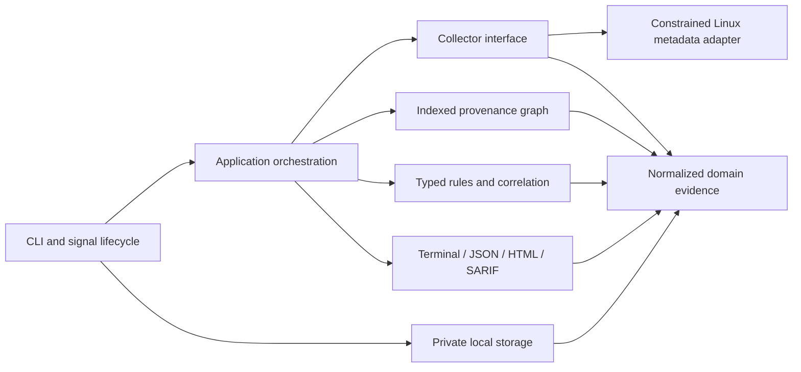

# System architecture

[Maintainer index](README.md)

## Boundaries

LASA is a single local binary. There is no mandatory network service, graph database, runtime API connection or backend. The following dependency direction keeps Linux access out of rule evaluation and rendering:

`internal/domain` has no dependency on platform collectors. The correlation engine accepts a normalized snapshot and validated rule definitions. It does not open files, spawn commands, query a remote service or interpret arbitrary query strings. The filesystem collector and optional sensor are adapters; output formats render recorded evidence without rescanning.

## Scan lifecycle

The CLI validates profile, budgets, report flags, local rule pack and suppression policy before meaningful host collection. Linux initialization resolves a pseudonymous machine identity, boot/kernel scope and scanner namespace identities. Deep mode requires explicitly authorized UID 0 and never runs sudo.

Application stages preserve dependencies while limiting concurrency:

1. Process and kernel collection, plus an explicitly requested sensor window, run as a bounded stage.
2. Network namespace collection and identity/mount collection use the visible process inventory.
3. Scoped filesystem metadata collection uses its own pinned metadata operations.
4. The application combines coverage, stamps completion, builds the graph, evaluates rules, generates fingerprints/scores and sorts output.
5. The CLI applies the suppression policy, renders, atomically persists or writes stdout, then determines exit status.

The `Engine` takes a host identity, rule pack and stage factories. Tests inject collectors without requiring real Linux state. Stage fan-out is capped at eight; process fan-out is a configured worker pool, never one goroutine per PID. Cancellation propagates through the shared context; report production still records a partial result when collection returns after a deadline.

## Evidence semantics

An observation is a subject/key/value fact with state, source, collector identity, timestamp and optional redaction/error metadata. Derived graph observations carry their supporting observation IDs. Findings recursively expand this provenance. Sources indicate metadata paths or local correlation, never an invented exploit test.

Four states are explicit: observed, not observed, unknown and not applicable. Required missing or conflicting evidence prevents a rule match. A match establishes the risky combination, not successful exploitation. Prerequisites and the hypothetical compromise step are stored separately from observed graph relationships.

Snapshots are time-bounded observations of a changing host, not atomic whole-system transactions. A process can exec, open a socket or disappear between reads. Start-time verification protects against PID reuse; pinned descriptors protect file identity. Neither makes the entire host snapshot simultaneous. Findings and drift logic retain uncertainty where required observations were not established.

## Graph and attack scenarios

The graph uses indexed nodes and outgoing edges. Nodes include host, process, service, identity, socket, namespace, mount, file, container hint and security control, plus capability/executable and opt-in inspection asset nodes. Relationships are added only when their provenance exists.

The current graph emits `RUNS_AS`, `LISTENS_ON`, `HOLDS_SOCKET`, `IN_NAMESPACE`, `BELONGS_TO_CONTAINER`, `MOUNTS`, `EXECUTES`, `HAS_CAPABILITY`, `PROTECTED_BY` and `SHARES_NAMESPACE_WITH` where the relevant evidence exists. Namespace sharing uses one deterministic representative per namespace to bound edge growth rather than materializing every pair. `PROTECTED_BY` records configured seccomp/NoNewPrivs context; it does not claim the protection is effective or reduce risk automatically.

Traversal is depth/budget bounded, stably ordered and cycle protected. Rule evaluation uses registered facts rather than an arbitrary graph query language. A finding's path is a depth-three, 64-relationship supporting local evidence subgraph plus explicit conditional compromise/impact text. It is not an invented linear exploit route through every neighbor. Current correlations do not implement distributed lateral movement search or a multi-host enterprise attack graph.

`CAN_WRITE` is intentionally not emitted as a universal host guarantee. Optional inspections evaluate local discretionary access across identity/group data, ACLs, search/sticky rules and observed mounts; mandatory policy, arbitrary external identities and concurrent changes remain qualifications. Permission metadata produces candidate risk, and the report says so. File `EXECUTES` association requires matching pinned device/inode evidence; path text alone does not prove which current file is running.

## Privacy and trust

The host, procfs strings, rule files and saved reports are untrusted. The default scan reads fixed metadata sources and configured metadata roots without argv/environ, executable bytes, keys, configuration contents, payloads or arbitrary descriptors. Explicit inspection modules expand native/configuration access as specified in [inspection design](inspection-design.md); selected native/API responses can contain arguments or environment values transiently, which are discarded before persistence. Raw machine ID is hashed before reporting. Other names and paths remain sensitive metadata, as documented in the customer privacy guide.

The kernel is the source of truth for Linux metadata; a compromised kernel or root actor can falsify or hide it. A report is not cryptographically signed at scan time. SecureObs ingestion must authenticate transport and asset mapping independently. The scanner never follows network or filesystem instructions embedded in report strings.

## Operational separation

Dependencies, binary files and generated BPF objects are retained artifacts. Daemon processes, BPF links/maps and open connections are live state and must be restarted. Scheduled scans are sequential. Local retention and an exclusive state-directory lock require no server. The optional sensor records windows, not continuous daemon-wide surveillance.

Future integrations should consume the versioned JSON contract while preserving coverage, unknowns, provenance and suppressions. They should not introduce backend dependencies into the one-shot scan path.
